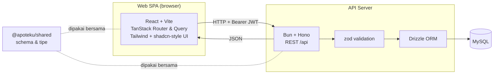
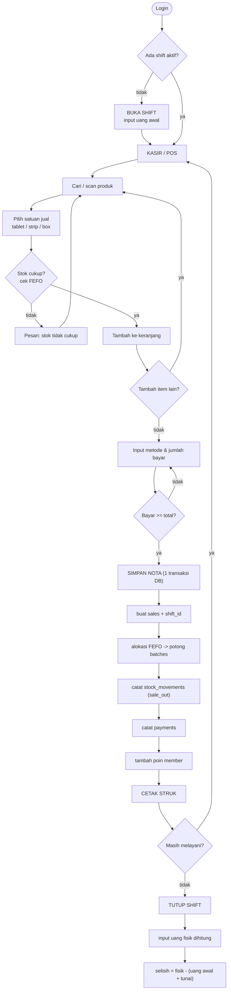
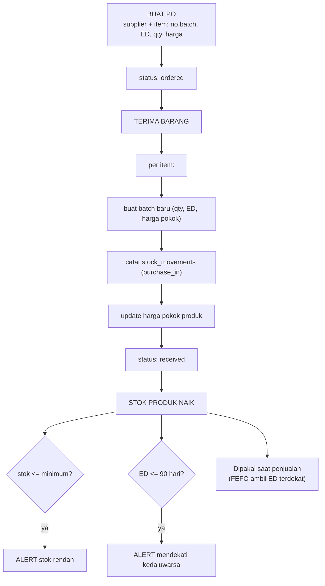
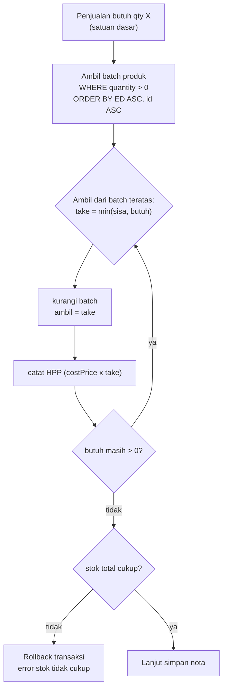
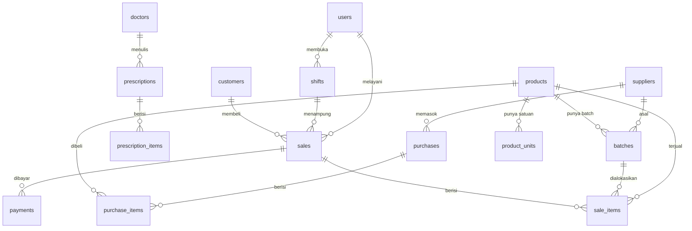

# Flowchart Apoteku

Diagram alur sistem. Versi Mermaid bisa dirender di VS Code (ekstensi Markdown Preview
Mermaid), GitHub, atau https://mermaid.live.

---

## 1. Arsitektur

---

## 2. Alur transaksi kasir (POS + shift + struk)

---

## 3. Alur pengadaan & stok

---

## 4. Detail alokasi FEFO

---

## 5. Model data inti

